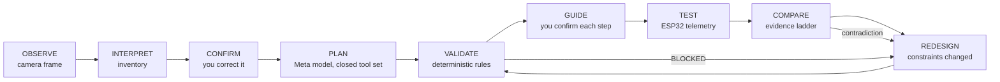

# BuildLoop AI

**From physical reality to verified engineering.**

BuildLoop is a reality-synced engineering agent for low-voltage electronics. It observes a workbench, keeps a digital twin of
the parts you actually have, designs a circuit with a Meta model, checks it with deterministic electrical rules, guides the
build, drives an ESP32 only after you approve, and compares what happened with what was intended. When a part disappears it
invalidates the design, proposes a feasible alternative, and verifies that too.

Built for the Meta Global AI Developer Hackathon 2026 (Indie Developer, *Push the Frontier*).
See [docs/DEVELOPMENT_TIMELINE.md](docs/DEVELOPMENT_TIMELINE.md) for what was built when.

## Status (read this first)

Demo Mode works end to end with a **simulated** ESP32 and a deterministic planner, and says so on screen. The firmware compiles
for ESP32 and Arduino Uno but has **not been flashed or run**. No live Meta-model request has succeeded yet (no credentials /
credits). Nothing simulated is presented as real; see [docs/ROADMAP.md](docs/ROADMAP.md),
[docs/REAL_WORLD_VERIFICATION.md](docs/REAL_WORLD_VERIFICATION.md) and [docs/demo/KNOWN_LIMITATIONS.md](docs/demo/KNOWN_LIMITATIONS.md).

## How it works



- **Models propose, trusted code acts.** The model sees a closed set of read-only tools. Designs are built by trusted generators and
  re-validated; model text never becomes a serial command.
- **Provenance is explicit.** Detected, user-confirmed, validated and physically tested are different states and are never merged.
- **Honest evidence.** A command acknowledgement is not proof an LED lit. Verification is graded (command → GPIO → sensor → optical →
  physical) and simulated devices are capped and labelled.
- **Safety gates.** Actuation needs a validated design, confirmed assembly steps, a connected board and your explicit authorization.
  Opening a serial port needs separate approval. Firmware is never flashed by the app.

## Quick start (Windows PowerShell)

```powershell
git clone https://github.com/thulasiramk-2310/BuildLoop-AI.git; cd BuildLoop-AI
scripts\setup.ps1          # venv, dependencies, .env from .env.example
scripts\start.ps1          # API :8000, web https://localhost:5173 (use -Http for plain http)
scripts\stop.ps1
```

Open the app, choose **New Demo project → Load synthetic demo frame → Scan components** and follow the header's agent banner.
Cross-platform: `python -m venv .venv && .venv/bin/pip install -e "apps/api[dev]" && (cd apps/web && pnpm install --ignore-workspace) && cp .env.example .env`.

## Configuration (`.env`, never committed)

| Variable | Purpose |
|---|---|
| `MODEL_API_KEY` | Meta Model API (Muse Spark 1.3, SAM 3.1) |
| `REASONING_BACKEND` | `meta_api` (default) or `open_weight` |
| `HF_TOKEN` / `BASETEN_API_KEY` | Meta open-weight models via Hugging Face Inference Providers or Baseten; `OPEN_WEIGHT_PROVIDER`, `OPEN_WEIGHT_MODEL` override the preset |
| `PERCEPTION_BACKEND` | `sam` (default) or `vlm` (open-weight model inventory; no masks, not SAM) |

Open-weight output is always labelled as such and never presented as Meta Model API output. Real Mode never falls back to demo data.

```powershell
.\.venv\Scripts\python scripts\baseten_audit.py                    # read-only model catalog check
.\.venv\Scripts\python scripts\live_smoke.py --backend open_weight --vlm-image C:\path\frame.jpg
```

## Hardware

ESP32-DevKitC V4: LED on GPIO25 through ~220 Ω, photoresistor divider on GPIO34 (ADC1), 3V3 and GND. Wiring, firmware build and flashing
(done by you) are in [docs/hardware/SETUP.md](docs/hardware/SETUP.md). The Hardware tab lists serial ports read-only, requires approval to
open one, and runs a non-actuating first-validation checklist (handshake, protocol, heartbeat, telemetry, safe default LED state).

## Tests

```powershell
.\.venv\Scripts\python -m pytest apps/api -q
.\.venv\Scripts\python -m pytest tests/integration -c apps/api/pyproject.toml --rootdir . -q
cd apps\web; npx tsc -b --noEmit; npx vitest run; npx playwright test
```

Latest results: [docs/demo/TEST_REPORT.md](docs/demo/TEST_REPORT.md).

## Repository layout

`apps/api` FastAPI backend · `apps/web` React UI + Playwright tests · `firmware/` ESP32 and Uno · `packages/contracts` generated TypeScript
types · `scripts/` setup, diagnostics, smoke tests · `docs/` architecture, hardware, verification, demo · `tests/` integration and fixtures.

## License

MIT. See [LICENSE](LICENSE). Meta models and APIs are subject to their own licenses and terms.
